# 神临战队GODARRIVAL Mark1 ver2.0.3开发日志

## 1.方块携带——单一与多项

**描述**
在经过对CRTC规则深度的研究与讨论后，我组深刻认识到，在此次偏基础性的比赛中，视觉实现难度偏大且对本就不算复杂的赛制提升不大，而电控的实现趋于统一，无法在控制上与其他队伍拉开差距，因此，携带方块的机械实现方式便显得至关重要。项目初期，我们一直致力于找到一种新颖，简单，而具有效率的携带方式。最终，“门锁式”携带机构应运而生。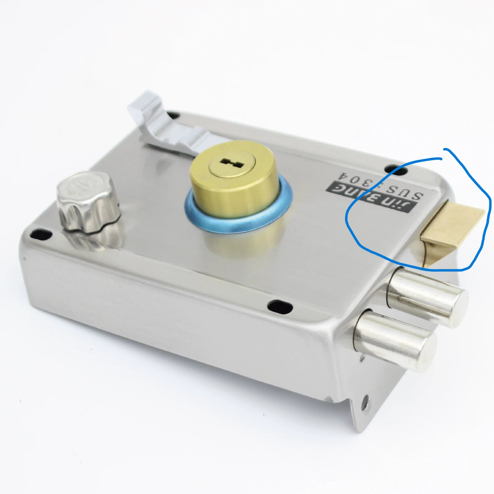
**实现**
我们计划在小车的底盘上安装一个仅由一个舵机操控，用弹力绳索实现升降的架式结构，中柱延伸出一个正方形框架并在顶点和中点伸出长短不一的八根柱式结构，每一个结构端头都有四块可形变的片状结构，当机构整体下降，片状机构形变并卡进能量单元中完成携带。最大的优点在于整套机构只用一个舵机操控，简洁到了极致，我们可以自信的保证，我组设备的可靠性将是整个参赛队伍中最高的。
**困难与解决**
  我们最初设想利用弹簧的伸缩卡住方块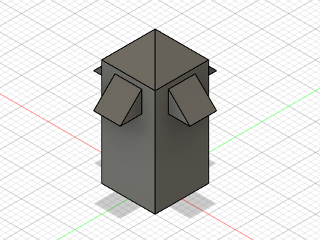 这种方案在使用时可靠性高且不用精细设计，但是其结构过于复杂，最终舍弃。
而后我们拿出第二版方案，利用PLA的弹性使之弯曲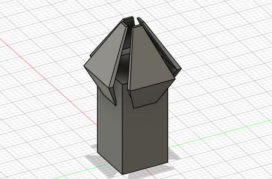优点：结构简单   缺点：方案不成熟，需要多次更改参数
在第一次落地尝试时，因为3d打印的强度不尽人意，结构在于能量单元发生作用时极易崩裂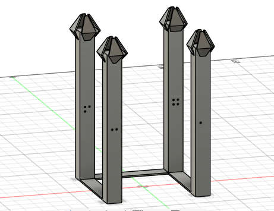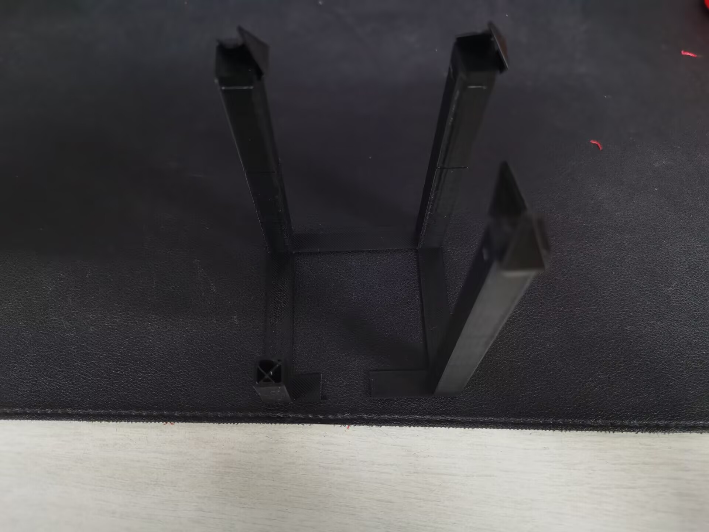，于是对受力结构进行了调整。最终我们确定了抓取模块的基本结构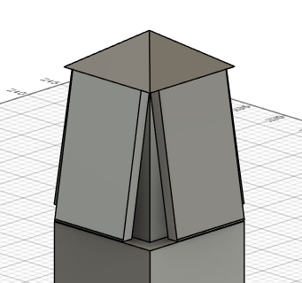并在多次调整后确定了其参数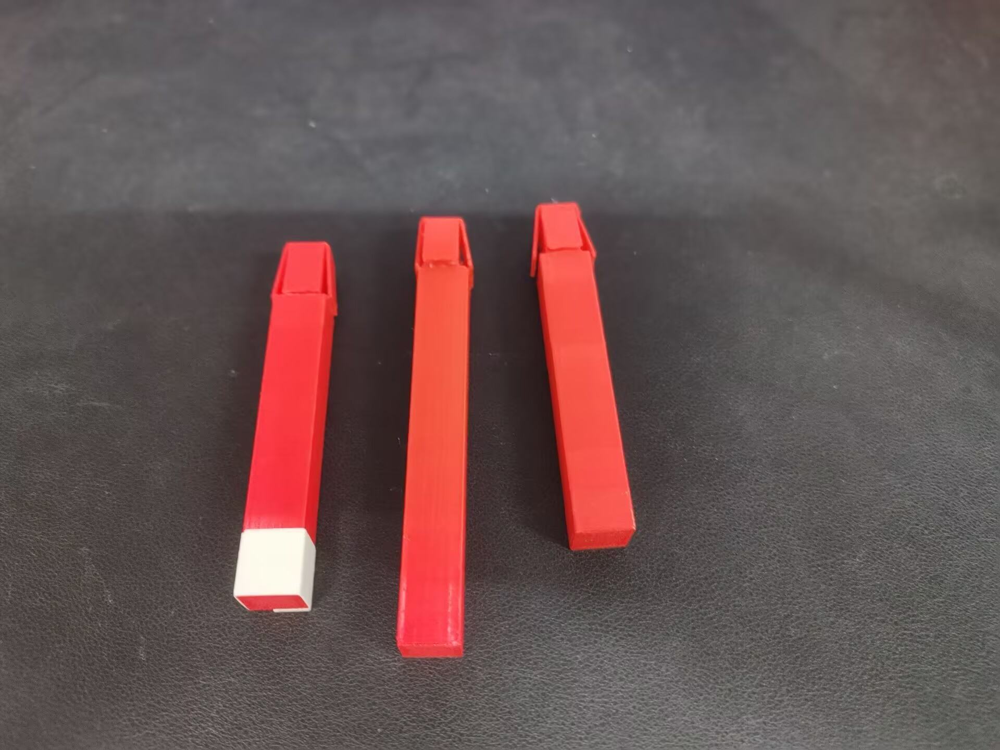

**注**
涉及到机械结构的报告包含大量图片与视频，在此文档中仅包含基本历程描述，如果您对我们的抓取机构工作原理感兴趣请移步文档外机械组提交的专门ppt。
  

## 2.外形展示，尺寸与结构稳定性
**同上**文档中仅展示开发思路
**简述**
在敲定抓取结构的基础上，我们开始开发车型方案，我们设计是把一号机器车用作纵向抓取，抓取高处的物体，比如焦点，高台处的方块，二号机器人用作水平抓取，利用墙壁抓取散落在地面上和洞内的方块，最终在结合车的最大尺寸要求后我们敲定了一号机器车和二号机器车的最终版型，根据场地的方块位置进行设计不同抓取头的高度差，使小车在特定位置能同时夹起多个方块，同时防止小车长宽高超过限制，削减了前方的抓取头使小车的长宽符合规定，对于一号机器车的抓取运动系统我们也进行了多次讨论和思考，最终敲定单个舵机+弹簧与绳子的方式控制抓取总部分上下移动，其优点为结构简单，原理清晰，易修理，成本低廉，在此区域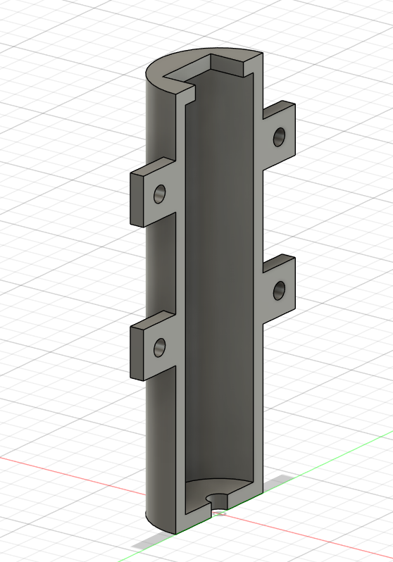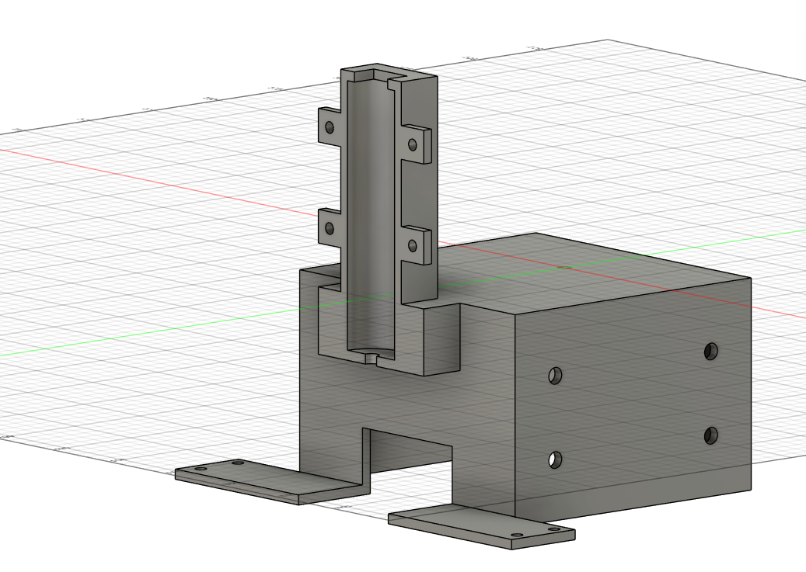放置弹簧和绳子，舵机正转，绳子变短，弹簧压缩，带动抓取头下降抓取方块，舵机反转，绳子变长，弹簧恢复原长使抓取头上升.

**历程**
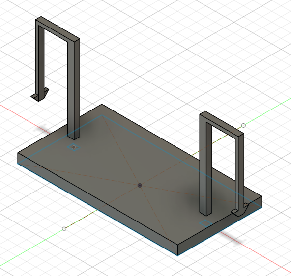
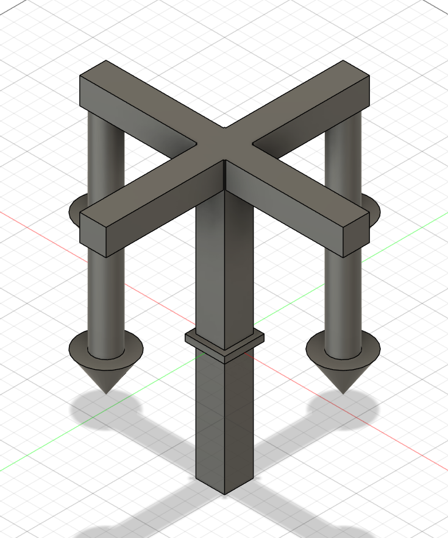
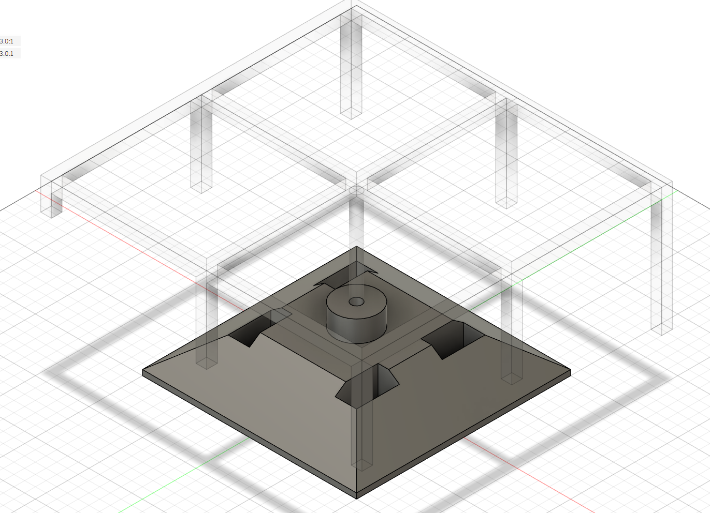

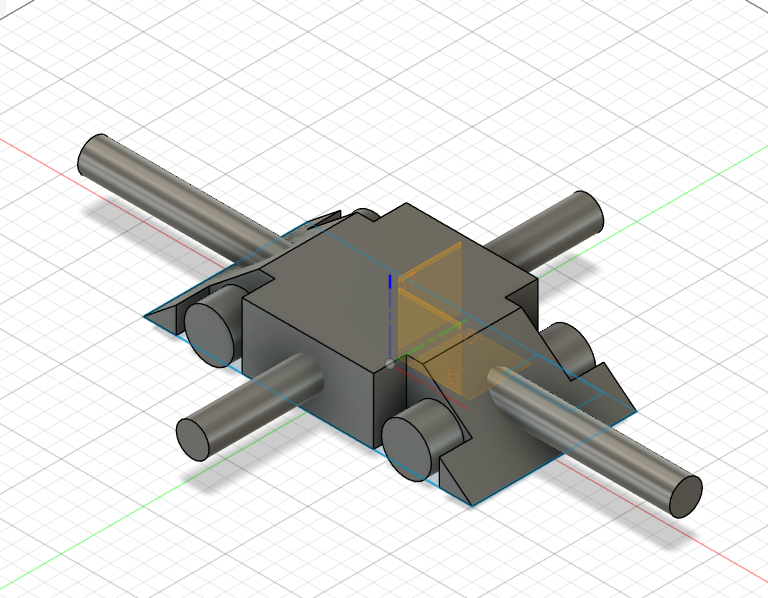
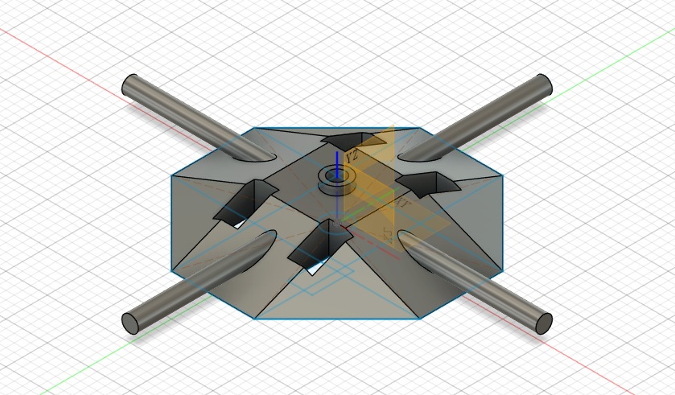
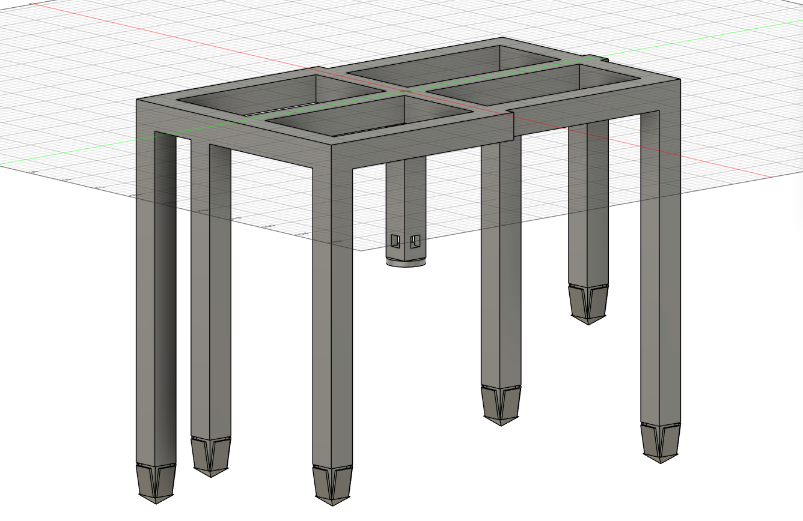

## 3.电机运动——单一与多项

**描述**
正如上所述，我们极力追求在机械上的创新，在控制上的简洁，因此，特别是对最底层的电机控制，我们把代码长度尽可能压缩到最小
**实现**
显然，为实现对电机转速的精准控制，我们使用晶振时钟输出pwm信号，并单独使用两根stby接口打开驱动板。下面展示驱动电机的基本函数
void setmotor(int motor_id,int direction){
  uint16_t pin1,pin2;
	switch(motor_id){
		case 1:pin1=GPIO_PIN_13;pin2=GPIO_PIN_12;break;
		case 2:pin1=GPIO_PIN_14;pin2=GPIO_PIN_15;break;
		case 3:pin1=GPIO_PIN_6;pin2=GPIO_PIN_5;break;
		case 4:pin1=GPIO_PIN_7;pin2=GPIO_PIN_8;break;
		default:return;
}
	if(direction > 0){
	  HAL_GPIO_WritePin(GPIOB,pin1,GPIO_PIN_SET);
    HAL_GPIO_WritePin(GPIOB,pin2,GPIO_PIN_RESET);		
	}
	else if(direction < 0){
	  HAL_GPIO_WritePin(GPIOB,pin1,GPIO_PIN_RESET);
		HAL_GPIO_WritePin(GPIOB,pin2,GPIO_PIN_SET);
	}
	else{
	  HAL_GPIO_WritePin(GPIOB,pin1,GPIO_PIN_RESET);
		HAL_GPIO_WritePin(GPIOB,pin2,GPIO_PIN_RESET);
	}}
**困难与解决**
在Mark1 ver1.3.2的开发中，由于未能解决精准获取ps2摇杆所在位置的数据，我们被迫采用四向移动的方式控制小车。但在后续研讨中，我们发现在小车过桥的场景下，在狭窄路段，轮胎打滑，重心不在几何中心等因素中，全向移动反而不能完成移动的任务，因此我们决定将四向移动作为一种模式保留。如下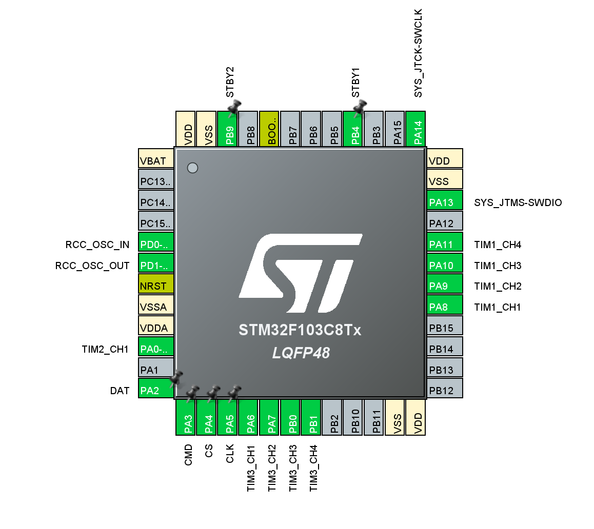
void chassis_forward(void){
  setmotor(1,-1);setmotor(2,-1);
	setmotor(3,1);setmotor(4,1);
}

void chassis_backward(void){
  setmotor(1,1);setmotor(2,1);
	setmotor(3,-1);setmotor(4,-1);
}

void chassis_right(void){
  setmotor(1,-1);setmotor(2,1);
	setmotor(3,-1);setmotor(4,1);
}

void chassis_left(void){
  setmotor(1,1);setmotor(2,-1);
	setmotor(3,1);setmotor(4,-1);
}

void chassis_stop(void){
  setmotor(1,0);setmotor(2,0);
	setmotor(3,0);setmotor(4,0);
}
全向移动如下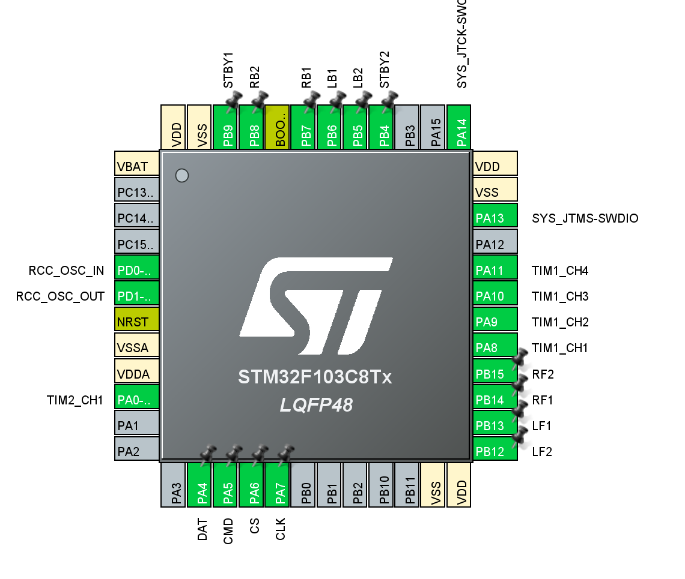
void chassis_move(int vx,int vy,int omega){
  int lf = vx - vy - omega;
	int rf = vx + vy + omega;
	int lb = vx + vy - omega;
	int rb = vx - vy + omega;
	
	setmotor(1,lf);setmotor(2,rf);
	setmotor(3,lb);setmotor(4,rb);
}
在进行全向可调速移动的研究时，我们发现马达仅有两根线，这意味着我们无法像网上教程一样两根线的高低电平控制正转反转，一根pwm控制转速。经过电控组的研究，我们最后拿出了另一种解决方案，即两个接口都接pwm，一个控制正向转速，一个控制反向转速，pwm设置如下
void setmotor(int motor_id,int speed){
  TIM_HandleTypeDef htim;
	uint32_t ch_for,ch_back;
	switch(motor_id){
	  case 1:htim=&htim1;ch_for=TIM_CHANNEL_2;ch_back=TIM_CHANNEL_1;break;
		case 2:htim=&htim1;ch_for=TIM_CHANNEL_3;ch_back=TIM_CHANNEL_4;break;
		case 3:htim=&htim3;ch_for=TIM_CHANNEL_3;ch_back=TIM_CHANNEL_4;break;
		case 4:htim=&htim3;ch_for=TIM_CHANNEL_1;ch_back=TIM_CHANNEL_2;break;
		default:return;
	}
	if(speed > 100)speed = 100;
	if(speed < -100)speed = -100;
	
	if(speed > 0){
	  __HAL_TIM_SET_COMPARE(htim,ch_for,(speed * 1000)/100);
		__HAL_TIM_SET_COMPARE(htim,ch_backr,0);
	} else if{
	  __HAL_TIM_SET_COMPARE(htim,ch_for,0);
		__HAL_TIM_SET_COMPARE(htim,ch_back,(-speed * 1000/100));
	} else if{
	  __HAL_TIM_SET_COMPARE(htim,ch_for,0);
	  __HAL_TIM_SET_COMPARE(htim,ch_back,0);
	}
}

## 4.舵机运动

**描述**
得益于优秀的机械设计，我们的结构对舵机的运行要求较低，只用以可靠的运动执行简单任务即可。倒是因为结构过于简洁，我们无法得到多个舵机运动的得分，这倒是有些许遗憾。
**实现**
如上所述，舵机的运动控制如下
extern TIM_HandleTypeDef htim2;

void servo_init(void){
  HAL_TIM_PWM_Start(&htim2,TIM_CHANNEL_1);
	servo_stop();
}

void servo_runforward(void){
  __HAL_TIM_SET_COMPARE(&htim2,TIM_CHANNEL_1,1000);
}

void servo_runbackward(void){
  __HAL_TIM_SET_COMPARE(&htim2,TIM_CHANNEL_1,2200);
}

void servo_stop(void){
  __HAL_TIM_SET_COMPARE(&htim2,TIM_CHANNEL_1,1500);
}
**困难与解决**
我们发现在实际应用中，抓取结构上升下降过慢会导致损失大量不必要的时间导致在比赛中失利，而过快的升降对操作手和结构强度都是不小的考验，因此我们花费了大量时间调整舵机的移动速率，并于机械组联手将舵机上的绳索结构纳入考虑中，最后我们将上升速度确定为30%而将下降改为50%。
